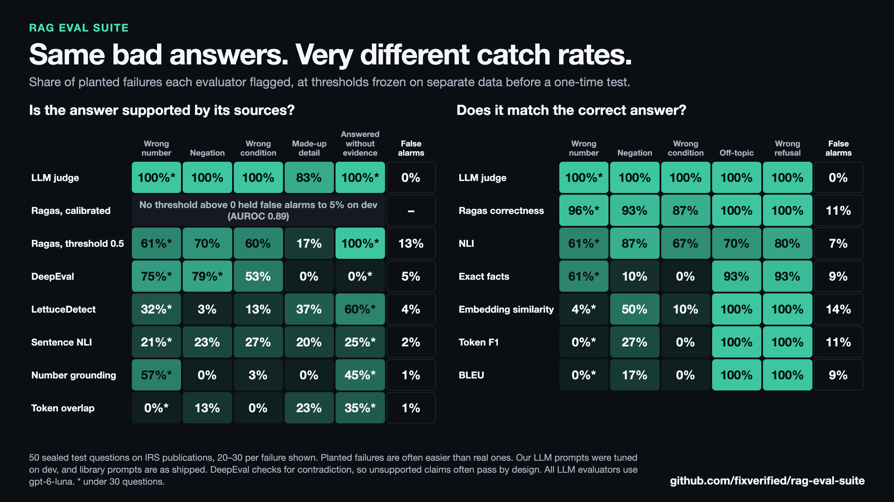

# rag-eval-suite

[](LICENSE)


Copy-and-paste RAG evaluators, each measured on the same labeled failures, so you can see what each one catches and misses before using it.



## Results

Evaluators were scored on 50 sealed questions, once, with thresholds frozen on separate data. A separate agent wrote these questions, but the builder knew the failure categories and exploit families, so this isn't full blinding. All numbers below are from that test. Full tables are in [RESULTS.md](docs/RESULTS.md).

- **Text-similarity metrics missed the failures that matter most.** `token_f1` and `bleu` flagged 0% of wrong numbers, and `embedding_similarity` flagged 4%.
- **Our dev-tuned faithfulness and correctness prompts, run on `gpt-6-luna`, flagged nearly every planted failure** with 0 of 30 questions showing false alarms: 100% of wrong numbers, negations and wrong conditions, and 83% of made-up details. All cases are planted, and clean controls derive from gold answers, so this says nothing about false alarms on real model answers.
- **`ragas.answer_correctness` came close on correctness,** at 87–96% on those three failures, with 11% false alarms instead of the 5% target.
- **Faithfulness split widely.** `deepeval.faithfulness` uses the same judge, and flagged 53–79% of those three failures and 0% of made-up details and answers without evidence. Its shipped prompt checks for contradiction, so that 0% is largely by design. `ragas.faithfulness` scored 0 on enough clean answers that no threshold above 0 held false alarms to 5%, though its AUROC was 0.89. At a 0.5 threshold, it flagged 60–70% of those failures, with 13% false alarms.
- **`lettucedetect` was uneven,** flagging 37% of made-up details and 3% of negations, at no API cost.
- **A rule-based refusal check overfit.** `abstention_rule` flagged 1 of 400 clean answers on dev. On test, where refusals were worded differently, it flagged 15 of 20 clean refusals.
- **Detecting missing evidence is harder.** On the 30 answerable test questions, `context_sufficiency_llm` caught 67%, `ragas.context_recall` 64%, `deepeval.contextual_recall` 61%, and `context_relevance_reranker` 20%.

These are planted failures, which are often easier than real ones, so don't read them as production recall. Most categories have 30 questions, but some have 14–28. With 30, a perfect 100% has a 95% lower bound near 89%.

## Choosing an evaluator

| Question | Evaluators | What you need |
|---|---|---|
| Did retrieval find the right source? | `recall_at_k`, `precision_at_k`, `hit_rate`, `mrr`, `average_precision`, `ndcg_at_k`, `evidence_coverage` | Labeled sources or quotes |
| Is the answer in the context? | `context_sufficiency_llm`, `context_relevance_reranker`, `signal_ratio` | LLM or reranker |
| Is the answer supported? | `faithfulness_llm`, `sentence_nli`, `number_grounding`, `token_support`, `span_detector`, `claim_nli` | LLM, NLI model or nothing |
| Are citations real and supported? | `citations_exist`, `citation_support`, `citation_coverage` | Available source ids, NLI model |
| Does it address the question? | `relevance_llm`, `embedding_relevance`, `cross_encoder_relevance`, `question_regeneration` | LLM, embeddings or cross-encoder |
| Does it match the known answer? | `correctness_llm`, `nli_correctness`, `exact_facts`, `token_f1`, `rouge_l`, `bleu`, `embedding_similarity` | A gold answer |
| Does it cover the required points? | `completeness_llm`, `key_point_nli`, `key_point_mean` | Key points |
| Does it decline at the right times? | `abstention_llm`, `abstention_rule`, `abstention_reranker` | An answerability label, or LLM or reranker |
| Are answers stable? | `number_consistency`, `semantic_consistency` | Repeated answers |

`claim_nli`, `question_regeneration`, the retrieval content metrics and robustness metrics are included with unit tests, but they don't have version 1 detection results.

## Using an evaluator

Each file in [`evaluators/`](evaluators) stands alone and uses only the Python standard library. Copy the one you need, and pass in your own model as a plain function:

```python
from faithfulness import faithfulness_llm

def llm(prompt: str) -> str:
    return client.chat.completions.create(
        model="your-model", messages=[{"role": "user", "content": prompt}]
    ).choices[0].message.content

result = faithfulness_llm(question, answer, contexts, llm, threshold=0.75)
result.score    # raw score, where higher is better
result.passed   # True or False against your threshold
result.details  # the judge's reason, for example
```

An unparseable judge reply raises `JudgeError`. Count it as an error, not as a score. Thresholds in the results were calibrated on this corpus and these models, so calibrate your own on labeled examples.

## How evaluators were measured

- **Corpus:** 10 IRS publications for tax year 2025, 406 pages, split by whole publication between dev and test.
- **Cases:** 1,123 dev and 664 test cases with labels known by construction: clean controls, 10 answer failure types, retrieval and context failures, and 7 exploit families. 4 exploit families were held out of dev.
- **Thresholds:** set on dev for at most 5% false alarms on clean controls, then frozen before the sealed test.
- **Unit:** recall and false alarms are computed per question, because variants of one question aren't independent.
- **Libraries:** Ragas 0.4.3 and DeepEval 4.3.2 use their shipped prompts and the same judge, in their own pinned environments.

The [protocol](docs/PROTOCOL.md) has the full method and change log, and the [scope table](docs/SCOPE.md) shows which evaluator was scored on what.

## Reproducing

```bash
python3 -m venv .venv
.venv/bin/pip install -r requirements/main.lock
PYTHONPATH=src:. .venv/bin/pytest
PYTHONPATH=src:scripts:. .venv/bin/python scripts/report.py
```

`report.py` rebuilds the results from saved scores in `data/scores`, with no API calls. To rerun the models, create `.venv-ragas` and `.venv-deepeval` from their lock files, add keys to `.env`, and run `scripts/run_dev.sh data/test_v1 results/raw/test`. New scores land in `results/raw`, so copy them to `data/scores` before running `report.py`.

## Limits

- **Version 1 is partial.** Not run: the chunks vs. full-document comparison, real generated-answer failures, memory control, repeat-run reliability, document-shift set, external datasets, and most other library metrics. See [RESULTS.md](docs/RESULTS.md#not-run-in-version-1).
- **Planted failures may be easier than real ones.** LLM judges in particular may score lower on real answers.
- **Our prompts were tuned on dev, while library prompts stayed as shipped.** Both library results also use dev-calibrated thresholds.
- **Results cover one corpus, one judge and one generator of cases.** `gpt-6-luna` isn't a dated snapshot.
- **Labels are AI-written and AI-audited.** Audits found and fixed label errors, but no human has reviewed them yet.
- **No pairwise significance tests were run,** so small differences aren't findings.
- **Not tax advice.** The corpus is only test material. Unaffiliated with the IRS, and IRS publications are credited as the source.

## Development note

This project was built with substantial assistance from Claude, including its code, test cases and reviews. Independent review and replication are especially welcome.

## License

Code is under the [Apache License 2.0](LICENSE). IRS publications are US Government works. Library names belong to their projects.
